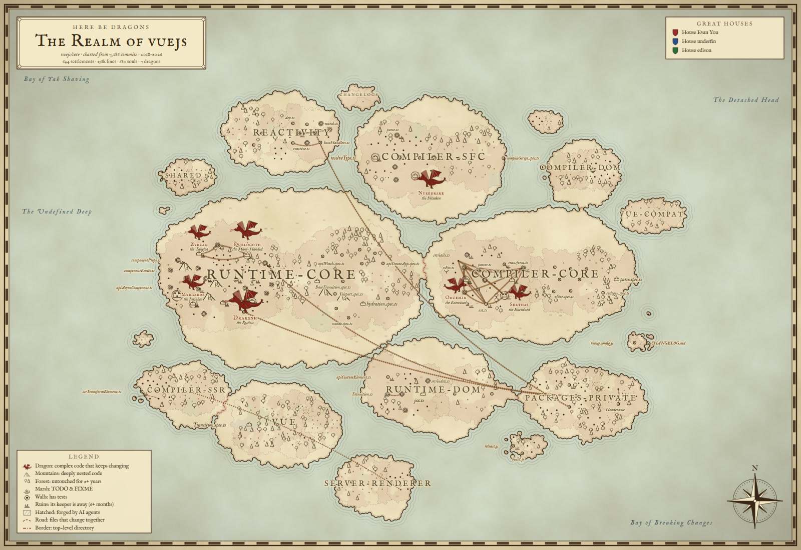
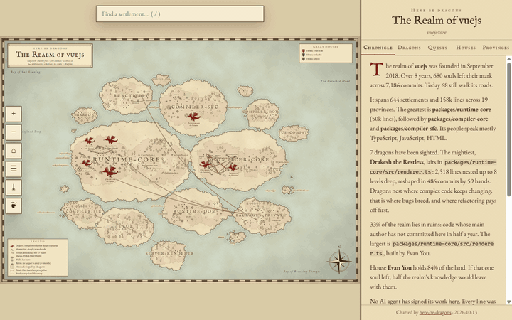

<div align="center">

<a href="https://rodrigoguedes09.github.io/here-be-dragons/atlas/vuejs-core.html">
  
</a>

# here-be-dragons

### Turn any git repo into a fantasy map. The dragons are real.

[](https://www.npmjs.com/package/here-be-dragons)
[](https://github.com/rodrigoguedes09/here-be-dragons/actions/workflows/ci.yml)
[](package.json)
[](#faq)
[](LICENSE)

```bash
npx here-be-dragons
```

**[Explore the gallery →](https://rodrigoguedes09.github.io/here-be-dragons/)** React · Vue · Django · Rails · Svelte · Vite · Tailwind · Express · Flask · FastAPI · Zod

</div>

---

Old cartographers drew dragons where their maps ran out: *hic sunt dracones*, here be dragons.

Your codebase has dragons too. They live in the files that are **complex** and **keep changing**. That is where bugs breed, where onboarding stalls, and where the next incident is already waiting. The trouble is, you can't see them. A file tree doesn't show them, and neither does a dependency graph.

**here-be-dragons** reads your git history and draws your repository as an explorable fantasy map, built from real analysis:

- **Islands** are your top-level folders.
- **Castles** are your biggest files.
- **Roads** connect files that secretly change together.
- **Ruins** mark code whose authors have moved on.
- **Dragons** sit on top of your real hotspots.

One command. No account, no upload, no config. Your code never leaves your machine.

<div align="center">

<br><sub>The interactive atlas. Zoom in, hover a settlement, click a dragon, read the chronicle, follow the quests.</sub>
</div>

## Quick start

```bash
npx here-be-dragons                    # map the repository you're in
npx here-be-dragons facebook/react     # map any public GitHub repository
npx here-be-dragons ~/code/my-app      # or any local path
```

It writes three files and opens the map in your browser:

| File | What it is |
|---|---|
| `here-be-dragons/map.html` | The interactive atlas. A single file you can share or host anywhere. |
| `here-be-dragons/map.svg` | A static map. Drop it in your README. |
| `here-be-dragons/realm.json` | Everything the survey found, for scripts, CI and AI agents. |

It runs on Node 18+ and git, with zero dependencies. A mid-sized repository (a few thousand commits) takes a couple of seconds.

## How to read the map

| On the map | In your code | How it's measured |
|---|---|---|
| 🐉 **Dragon** | A **hotspot**: complex code that changes a lot | Change frequency × indentation complexity, ranked against the rest of the repo |
| ⛰ **Mountains** | Deeply nested code | Indentation depth (a language-agnostic proxy for complexity) |
| 🌲 **Ancient forest** | Code nobody touched in 2+ years | Date of the last commit to each file |
| 🏰 **Castle / town / village** | Big / medium / small files | Lines of code × how often they change |
| 🧱 **Walls** around a town | The file has tests | A matching test file exists (`foo.ts` ↔ `foo.test.ts`, `test_foo.py`, `FooTest.java`…) |
| 🛤 **Roads** | Files that change together | Temporal coupling: shared commits ÷ average commits |
| 🏚 **Ruins** | Knowledge loss | The file's main author hasn't committed in 6 months |
| ▨ **Hatched land** | Written by AI agents | Commits signed by Claude, Codex, Copilot, Cursor, Devin, Jules, Aider, Gemini… |
| 🛡 **Great Houses** | Who owns what | The author who wrote most of each file |
| 🌿 **Marshes** | TODO / FIXME / HACK | Comment markers |
| **Islands & borders** | Top-level directories | Your folder structure (monorepos become archipelagos) |

The same repository always produces the same map. As your code changes, so does the world: provinces grow, forests spread, and dragons appear, move and (with some work) die.

## Why dragons? (the science bit)

The dragons aren't decoration. They come from **behavioral code analysis**, popularized by Adam Tornhill in [*Your Code as a Crime Scene*](https://pragprog.com/titles/atcrime2/your-code-as-a-crime-scene-second-edition/):

- **Hotspots.** Most of a codebase is rarely touched, and a small part changes all the time. When that small, busy part is also complex, it is where defects concentrate. Code churn is a well-known predictor of defect density (Nagappan & Ball, *[Use of Relative Code Churn Measures to Predict System Defect Density](https://www.microsoft.com/en-us/research/publication/use-of-relative-code-churn-measures-to-predict-system-defect-density/)*, ICSE 2005), and unhealthy hotspots are where teams lose the most time ([*Code Red*](https://arxiv.org/abs/2203.04374), 2022).
- **Temporal coupling.** Two files that keep changing in the same commits are bound together, whether or not an import says so. These hidden dependencies are invisible in the code and obvious in the history.
- **Knowledge loss.** Code mostly written by people who have moved on is code nobody nearby fully understands.

Tools that do this analysis are usually commercial dashboards. here-be-dragons does a focused, open-source version of it locally, in seconds, and makes it impossible to ignore.

## Your agent should know where the dragons are

AI coding agents edit hotspots as casually as anything else. Give them the map first.

**As a skill** (Claude Code, Codex, Cursor, OpenCode, Gemini CLI and anything that reads `SKILL.md`):

```bash
npx skills add rodrigoguedes09/here-be-dragons
```

The [skill](skills/here-be-dragons/SKILL.md) teaches your agent to:

- survey the repo before a risky change;
- take extra care in dragon files;
- check every **road** (if it edits `A`, it checks the files that always change with `A`);
- answer *"where should I start?"* from the prioritized quests.

**As JSON**, for any agent, script or CI job:

```bash
npx here-be-dragons --json
```

```jsonc
{
  "dragons":  [{ "path": "src/core/engine.ts", "revisions": 212, "loc": 2380, "maxDepth": 9, "authors": 14, ... }],
  "quests":   [{ "kind": "slay", "title": "Slay Vorathrax the Restless", "why": "...", "how": "..." }],
  "coupling": [{ "a": "src/router.ts", "b": "src/routes.ts", "shared": 31, "degree": 0.62 }],
  "hotspots": [...], "knowledgeLoss": [...], "provinces": [...], "chronicle": [...]
}
```

The AI layer works the other way around too: the map shows how much of a repository was *forged by AI*, and where.

## Keep a living map in your README

Add a workflow and your README always shows the current state of the realm:

```yaml
# .github/workflows/realm.yml
name: Redraw the realm
on:
  push:
    branches: [main]
permissions:
  contents: write
jobs:
  map:
    runs-on: ubuntu-latest
    steps:
      - uses: actions/checkout@v4
        with:
          fetch-depth: 0          # the map needs the whole history
      - uses: rodrigoguedes09/here-be-dragons@v1
        with:
          svg: .github/realm.svg
      - run: |
          git config user.name "github-actions[bot]"
          git config user.email "41898282+github-actions[bot]@users.noreply.github.com"
          git add .github/realm.svg
          git commit -m "Redraw the realm" || exit 0
          git push
```

```markdown

```

The action also writes the dragons, quests and chronicle to the job summary. Prefer a dark README? Use `theme: midnight`.

## Options

```text
npx here-be-dragons [path | github-url | owner/repo] [options]

Output
  -o, --out <dir>         where to write map.html, map.svg, realm.json (default: ./here-be-dragons)
      --svg <file>        also write the static map to this exact path
      --json              print the survey as JSON (nothing else is written)
      --md                print a Markdown report (great for PR comments)
      --full              with --json: include every file
      --theme <name>      parchment (default) or midnight
      --no-open           don't open the browser

Survey
      --since <date>      only read history since a date, e.g. "2 years ago"
      --max-commits <n>   read at most n commits (default 20000)
      --exclude <glob>    leave paths off the map (repeatable), e.g. "docs/**"
      --seed <text>       reshape the world (same seed, same map)
```

## Use it as a library

```js
import { survey } from 'here-be-dragons';

const { realm, svg, html, json } = await survey('.', { theme: 'midnight' });
console.log(realm.dragons.map((d) => `${d.name} ${d.title}: ${d.path}`));
```

Also exported: `analyze`, `layout`, `renderSVG`, `renderHTML`, `toJSON`, `toMarkdown`, `chronicle`, `quests`.

## FAQ

**Does my code leave my machine?**
No. Everything runs locally: git, the analysis and the drawing. The only network request is optional web fonts when you open the HTML map. Mapping a GitHub repository by name simply clones it.

**Is a dragon a bad file?**
It's a file that deserves attention. Some dragons are the beating heart of a project (React's work loop is a dragon, and it should be). The map tells you where care, tests and refactoring pay off the most, not who to blame.

**My map has no dragons.**
Lucky you. Dragons need both complexity and frequent change. Young repositories and very calm ones often have none.

**My repository is huge.**
Use `--since "1 year ago"` or `--max-commits` to focus on recent history, and `--exclude` to drop generated or vendored folders. Fixtures, snapshots, lockfiles, `dist/` and `node_modules/` are already handled.

**The map looks empty or every file is "ancient".**
You're probably on a shallow clone (common in CI). Run `git fetch --unshallow`, or use `fetch-depth: 0` with `actions/checkout`.

**How is AI authorship detected?**
From commit trailers and bot identities that agents leave behind (`Co-Authored-By: Claude`, `copilot-swe-agent`, `cursoragent@cursor.com`, `aider:` and others). Work from agents that don't sign their commits can't be detected.

**Which languages are supported?**
All of them. The analysis is language-agnostic: git history plus indentation. More than 90 file types are recognized.

## Contributing

Ideas, bug reports and pull requests are welcome. See [CONTRIBUTING.md](CONTRIBUTING.md). Good first quests: new biome ideas, better test-file pairing for your favorite language, map themes, and your repository's map in the gallery.

```bash
git clone https://github.com/rodrigoguedes09/here-be-dragons
cd here-be-dragons
npm test
node bin/cli.js .
```

## License

[MIT](LICENSE). Triangulation by [Delaunator](https://github.com/mapbox/delaunator) and circle packing from [d3-hierarchy](https://github.com/d3/d3-hierarchy) (both ISC, vendored). Fonts: [IM Fell](https://iginomarini.com/fell/the-revival-fonts/) by Igino Marini.

<div align="center"><br><sub>If this map showed you a dragon you didn't know about, consider giving it a ⭐ so other explorers can find it.</sub></div>
